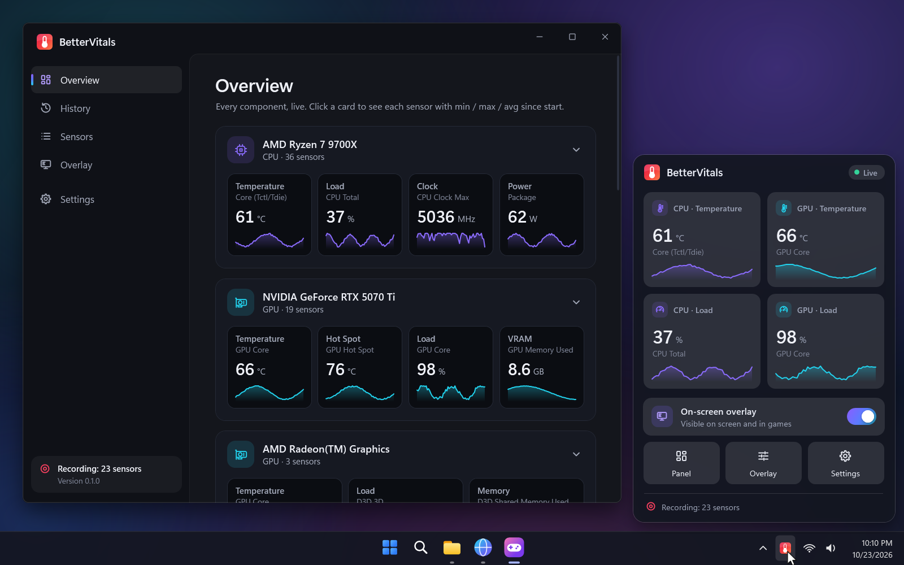
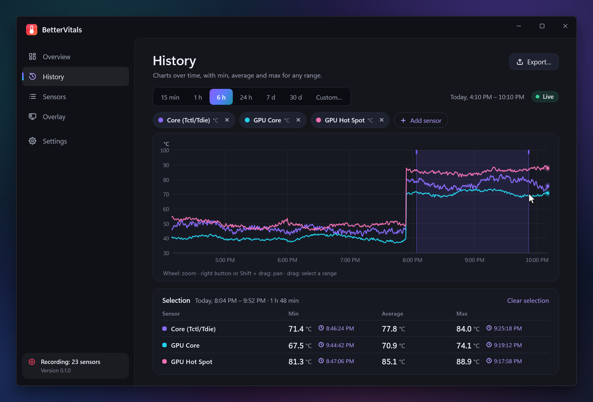
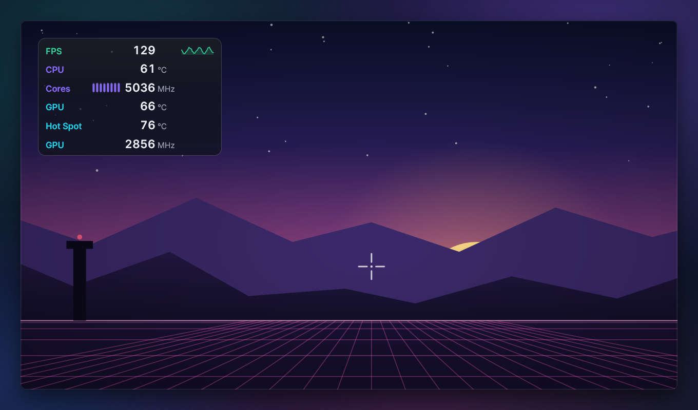
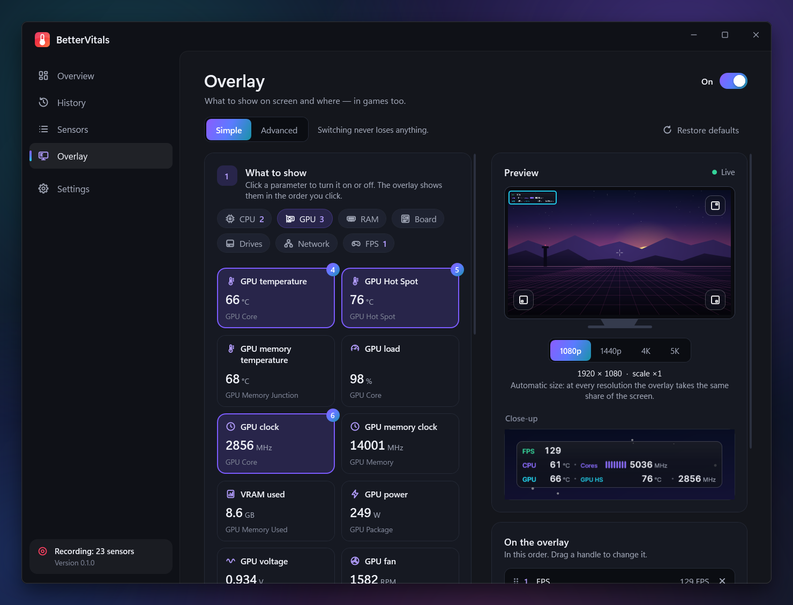
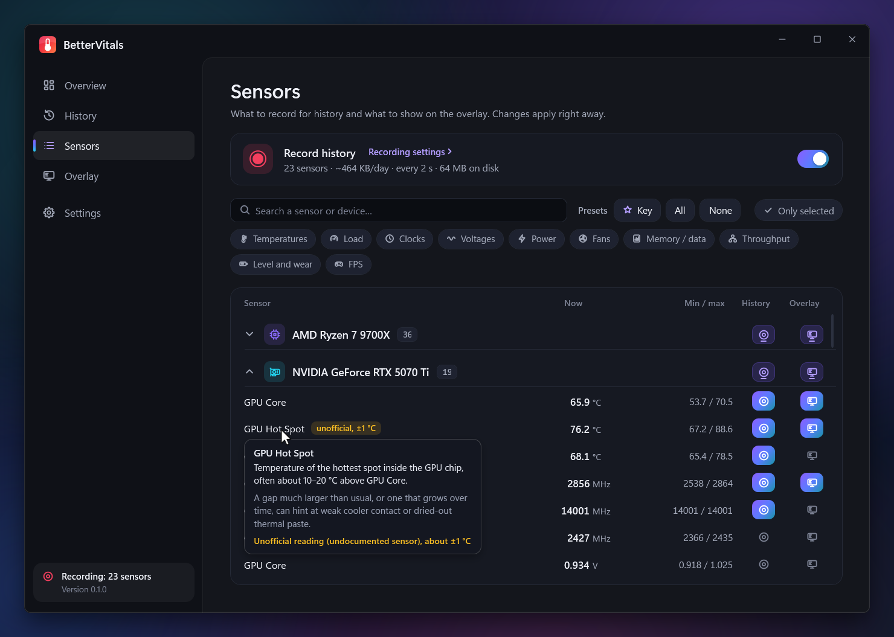

# BetterVitals

A light hardware monitor for Windows 11 that lives in the tray: temperatures, loads, clocks, power, fans and FPS, live and over time.

## History

Choose what to record and browse it on charts. Drag across a range to get its min, average and max, and when they happened.

## Overlay in games

The values you pick, on top of any game or app. It draws in its own window, nothing is injected into the game, and it stays out of streams and recordings.

## Set it up in a minute

Click the values you want and pick a corner; the preview shows the result. Advanced mode changes fonts, colors, sizes and layout.

## Sensors

Two switches per sensor: record it, show it on the overlay. Hover a name for a short explanation of what it measures.

- **Hardware:** CPU, GPU, motherboard, RAM, drives, network, fans and FPS on Intel, AMD and NVIDIA.
- **Light:** built to use as little CPU and memory as possible while it records. Live-only mode writes nothing to disk.
- **Offline:** the only connection is an optional update check.
- **Languages:** English and Polish.

## License

[MIT](LICENSE)
